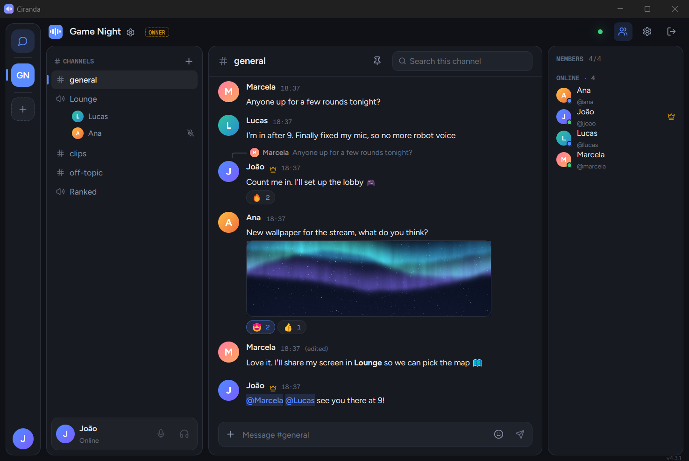
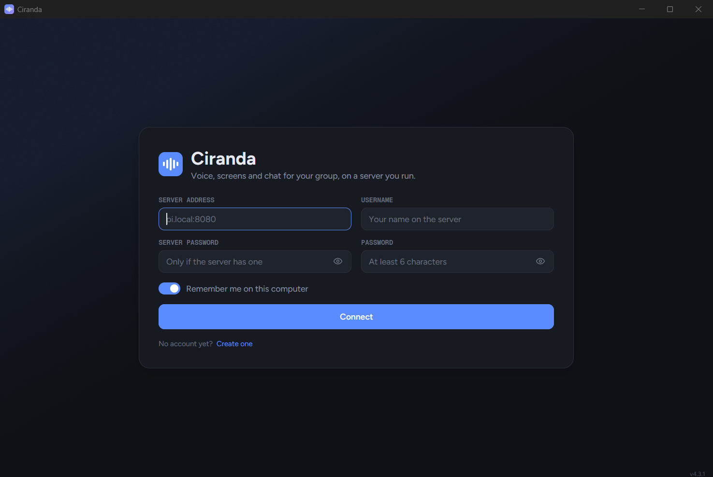

<h1> Ciranda</h1>

**Self-hosted voice, screen sharing and chat for a group of friends.**
Voice channels with screen and camera sharing, text channels, and private
conversations and calls, on a server you run. Latency stays under a second
because the server relays video and never re-encodes it.

[](https://github.com/Brunovncs/ciranda/releases/latest)
[](https://github.com/Brunovncs/ciranda/releases/latest)
[](https://github.com/Brunovncs/ciranda/releases/latest)



## How it is built

**Client.** A native app for Windows, macOS and Linux, written in Rust on [GPUI](https://www.gpui.rs/),
the UI framework behind the Zed editor: a single `ciranda.exe`, with no browser
engine inside. Media goes over WebRTC through
[LiveKit's libwebrtc bindings](https://github.com/livekit/rust-sdks). Video stays
YUV from the decoder to the screen, where the GPU uploads, converts and scales
it. Screen shares are encoded by the graphics card's H.264 encoder through Media
Foundation (NVIDIA, AMD or Intel), with a software fallback. Cameras and screen
shares reconnect by themselves after a network blip.

**Server.** A Node.js control server (accounts, channels, messages, signaling,
SQLite storage) beside [MediaMTX](https://github.com/bluenviron/mediamtx), which
relays media without decoding a frame. A Raspberry Pi is enough; upload
bandwidth is the only real limit.

**Private conversations** are end-to-end encrypted. Each account's key is made
on your computer (X25519), messages, files, reactions and call keys are sealed
with XChaCha20-Poly1305, and the server only stores and forwards ciphertext. A
recovery key brings your history to another computer.

## Features

- **Screen or window sharing** at up to native resolution and 120 fps, with its
  sound: the whole computer except the call, or just the shared app.
- **Voice channels** with cameras and screen shares, echo cancellation, neural
  noise suppression (DeepFilterNet: keyboards and dogs too, not just fans),
  per-person volume up to 350%, mute, deafen and a shared soundboard. Going to
  another server keeps you in your voice channel or call; the rail marks where
  you are heard.
- **Camera backgrounds**: blur, six bundled pictures or one of your own. The
  person is cut out on your computer by a small segmentation model; only the
  finished picture is sent.
- **Text channels** with Markdown, replies, edit history, attachments,
  screenshots, reactions, custom emoji, mentions, pins and search.
- **Private messages and calls**, from every server you are on, in one place:
  talk to a friend on another server without leaving your voice channel.
- **Accounts and roles**: owner, admins and members, password-locked channels,
  and one settings page to run the server.
- **Global hotkeys** for mute, deafen and soundboard sounds, working while a game
  has focus.
- **Several servers** on a rail on the left, one click apart.
- **Automatic updates**, checked against the published SHA-256 and applied after
  your call ends.
- **English and Portuguese**, following the system or picked in Settings.

## Install

### Client (Windows 10 and 11)

Download `ciranda-<version>-windows-x64-setup.exe` from the
**[latest release](https://github.com/Brunovncs/ciranda/releases/latest)**. It
installs for your user only, without an administrator prompt, and asks whether
to add shortcuts to the Start menu and the desktop. Uninstalling, from Windows'
installed apps, asks whether to keep your settings or remove everything,
`%APPDATA%\Ciranda` included. The same release has
`ciranda-<version>-windows-x64.exe`, the program alone, to keep in any folder
you can write to.



Sign in with the server's address (`https://chat.example.com:8444`, or
`192.168.1.50:8080` on a LAN), a username and a password, or create an account
there. On a new server, whoever installed it pastes the **owner key** the server
printed on its first start when creating their account; everyone else leaves it
empty.

Ciranda checks GitHub for a new release when it opens and every 6 hours. When
one is out, an Update button shows at the top of the window: it downloads the
new program, checks its SHA-256, swaps it in and restarts, waiting for your call
to end if you are in one. Settings, Advanced, "Check for updates" turns this
off.

### Client (Windows on Arm)

The same release has `ciranda-<version>-windows-arm64-setup.exe` and
`ciranda-<version>-windows-arm64.exe`, built for Arm processors (Snapdragon and
the like). They install and update the same way. The x64 installer, started on
an Arm computer, offers to open the release page for the Arm one instead.

### Client (macOS 12.3 or later, Apple silicon and Intel)

Download `ciranda-<version>-macos-universal.dmg`, open it and drag Ciranda to
Applications. Ciranda is not notarized by Apple, so the first launch is blocked:
right-click Ciranda and choose **Open**, or on macOS 15 and later try once, then
go to **System Settings → Privacy & Security** and click **Open Anyway**
(`xattr -dr com.apple.quarantine /Applications/Ciranda.app` does the same). macOS
asks for the microphone, the camera and screen recording the first time each is
used; the app is signed with the same certificate in every release, so those
answers carry over to the next version. Settings live in
`~/Library/Application Support/Ciranda`.

### Client (Linux, x86-64)

Download `ciranda-<version>-linux-x64.AppImage`, make it executable
(`chmod +x`) and run it. It needs glibc 2.35 or newer (Ubuntu 22.04, Debian 12,
Fedora 36 and later). On a Wayland desktop it runs through XWayland, which gives
it a title bar everywhere; `CIRANDA_WAYLAND=1` runs it on Wayland itself, for
desktops that draw title bars for their windows (KDE, not GNOME). The AppImage
carries its update information, so
[AppImageUpdate](https://github.com/AppImageCommunity/AppImageUpdate) (or a
launcher built on it, such as Gear Lever or AppImageLauncher) brings it to the
latest release, downloading only what changed.

On macOS and Linux an update from inside Ciranda is a new download: the Update
button opens the release's page. These are new, so a few things are still Windows only: the
notification-area icon (closing the window quits), global hotkeys, sharing an
app's sound, replays and the graphics card's H.264 encoder (video is encoded in
software).

### Server (Linux, x86-64 or arm64)

With the installer, on Debian, Ubuntu or Raspberry Pi OS:

```bash
git clone https://github.com/Brunovncs/ciranda.git
cd ciranda/server
sudo ./install.sh
```

It installs MediaMTX and the control server as systemd services, then walks you
through the domain, HTTPS (Caddy, certbot over Cloudflare DNS, or your own
proxy) and the optional server password, and prints the owner key. To upgrade:
`git pull && sudo ./install.sh`.

Or with Docker, which builds the image from the same checkout:

```bash
git clone https://github.com/Brunovncs/ciranda.git
cd ciranda/docker
cp .env.example .env        # the public address and the signaling URL
docker compose up -d --build
```

Either way, forward **UDP and TCP 8189** (media) and your HTTPS port (signaling
and API) to the server. Media cannot go through a proxy or a tunnel; it has to
reach the server directly. Ports, TLS, dynamic IPs and troubleshooting are in
**[DEPLOYMENT.md](DEPLOYMENT.md)**.

### Building the client

With [Rust](https://rustup.rs/) and the Visual Studio Build Tools (C++ workload)
on Windows, Xcode's command line tools on macOS, or on Linux clang 21 or later
(`CC=clang-21 CXX=clang++-21`) and the packages in
`client/packaging/linux/build-deps.txt`:

```bash
cargo build --release --manifest-path client/Cargo.toml   # -> client/target/release/ciranda(.exe)
```

rustup installs the Rust version `rust-toolchain.toml` pins, the one CI checks
with, with its clippy and rustfmt; CI also wants `cargo fmt --check` and
`cargo clippy --all-targets -- -D warnings` clean, and `cargo deny check`
(`client/deny.toml`) passing. A build made this way never replaces itself
through the updater.

The packages (`client/packaging/`: the Inno Setup script, `linux/appimage.sh`,
`macos/bundle.sh`) carry the crates' licences, written first with
[cargo-about](https://github.com/EmbarkStudios/cargo-about), from `client/`:

```bash
cargo about generate --locked -o target/THIRD_PARTY_LICENSES.txt about.hbs
```

## Built on

[MediaMTX](https://github.com/bluenviron/mediamtx) ·
[GPUI](https://www.gpui.rs/) ·
[LiveKit's libwebrtc bindings](https://github.com/livekit/rust-sdks) ·
[tract](https://github.com/sonos/tract) ·
[MediaPipe selfie segmentation](https://huggingface.co/onnx-community/mediapipe_selfie_segmentation) ·
[DeepFilterNet](https://github.com/Rikorose/DeepFilterNet) ·
[Figtree](https://github.com/erikdkennedy/figtree) ·
[Geist Mono](https://vercel.com/font) ·
[Lucide](https://lucide.dev/)

## Credits and license

Harmony, which Ciranda is built on, was created by
[Pedro Lucas Miguel](https://github.com/PedroLucasMiguel). The GPUI client and
the changes in this fork are by
[Brunovncs](https://github.com/Brunovncs). Third-party material in the client is
listed in [client/THIRD_PARTY_NOTICES.md](client/THIRD_PARTY_NOTICES.md).

MIT, see [LICENSE](LICENSE).

---

## Disclaimer: vibe-coded

> [!WARNING]
> **Every line of this repository (client, server, tests and docs) was written
> by an AI coding assistant**, prompted by a human who did not review it line by
> line. It is a recreational project, built for fun and for a handful of
> friends.
>
> It works and has run for a small group, but it has had **no security review,
> no audit and no abuse controls**, and comes with **no stability guarantees**.
> Use it on a LAN or among people you trust, not for anything that matters when
> it breaks. **No warranty.**
